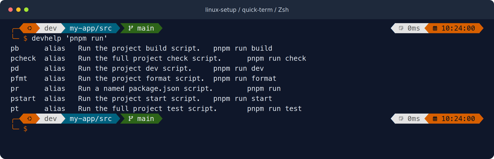

# linux-setup

A Linux terminal setup with Zsh, Oh My Posh, tmux, developer tools, GitHub account
profiles, and an optional AI skill manager. Built for Ubuntu/Debian, including WSL.

[](https://github.com/1hubengineering/linux-setup/actions/workflows/test.yml)

[Install](#install) · [User guides](docs/README.md) · [Terminal previews](docs/previews.md)



## Install

First, update and upgrade Ubuntu/Debian, then install the tools needed to clone
and run the setup. Review the package changes and restart Linux if requested.
Run these commands inside Ubuntu when using WSL:

```sh
sudo apt update && sudo apt upgrade
sudo apt install --no-install-recommends git curl ca-certificates python3
```

After that, clone and install as your normal user:

```sh
git clone https://github.com/1hubengineering/linux-setup.git ~/linux-setup
cd ~/linux-setup
./install.sh --preflight && ./install.sh --dry-run && ./install.sh
```

When installation succeeds, start Zsh:

```sh
export PATH="$HOME/.local/bin:$PATH"
exec zsh
```

Then run `linux-doctor`. The installer prints font instructions for your
environment and the command to make Zsh your default shell. Keep the checkout:
your live configuration links to it.

Setup installs missing base tools without sudo on Ubuntu/Debian and backs up
existing configuration. It offers GitHub account setup and AI skills during an
interactive first run. Move through menus with **arrow keys**, toggle multiple
choices with **Space**, and press **Enter** to confirm. **Esc** goes back.

Rerun `./install.sh` after a failed or interrupted installation. Completed tools
are kept; available pinned updates require confirmation. See
[rerun and recovery](docs/recovery.md).

[Installation details and supported systems](docs/installation.md) ·
[Fix unreadable icons or set the default shell](docs/fonts-and-shell.md)

## Start using it

| I want to… | Run | Guide |
| --- | --- | --- |
| Update my terminal setup | `update` | [Updates](docs/installation.md#update-an-existing-installation) |
| Change my prompt theme | `theme-manager` | [Themes](docs/themes.md) |
| Add, switch, or remove a GitHub profile | `git-profile` | [GitHub accounts](docs/github-accounts.md) |
| Install or remove AI skills | `skill-manager` | [AI skills](docs/skills.md) |
| Find a shortcut | **Alt+X** or `devcommands` | [Commands](docs/commands.md) |
| Check my setup | `linux-doctor` | [Troubleshooting](docs/troubleshooting.md) |
| See font and shell instructions again | `linux-setup-guide` | [Fonts and shell](docs/fonts-and-shell.md) |

[All user guides](docs/README.md) cover project checks, browser testing, databases,
updates, and uninstalling. See [included tools](docs/tools.md) for the full tool
list and [development](docs/development.md) to contribute.

Report problems through [GitHub Issues](https://github.com/1hubengineering/linux-setup/issues)
with your distribution, architecture, and redacted error output.
[Third-party notices](NOTICE.md).
