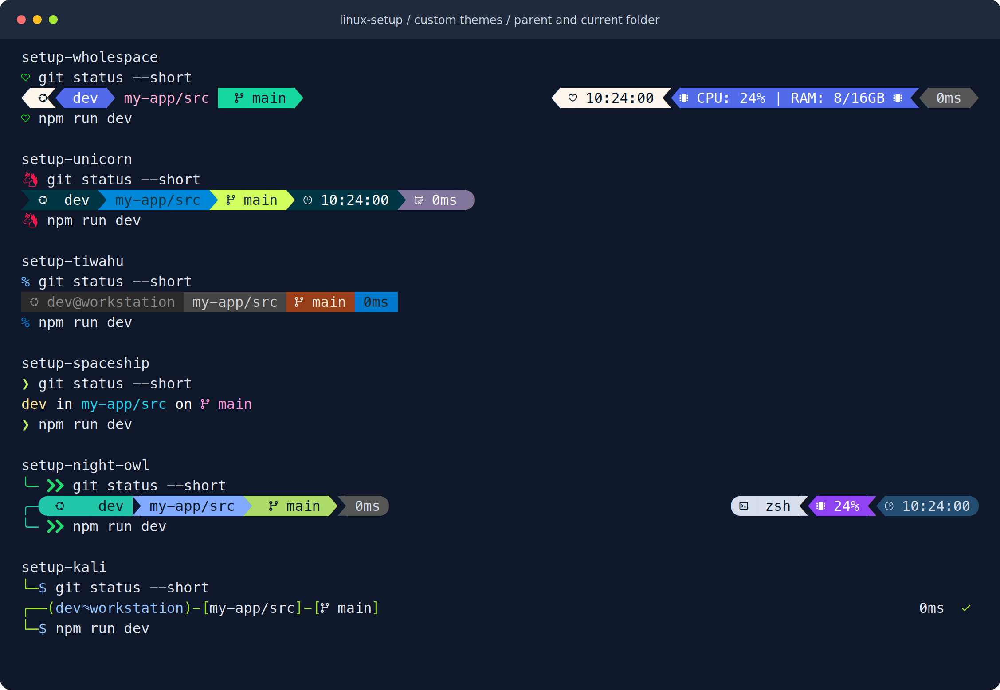
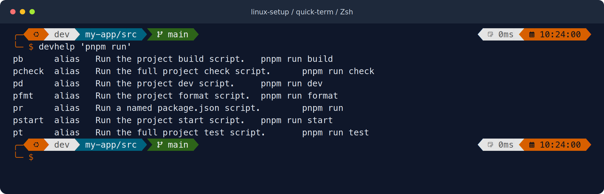
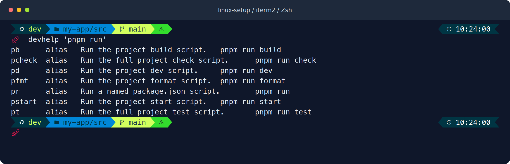
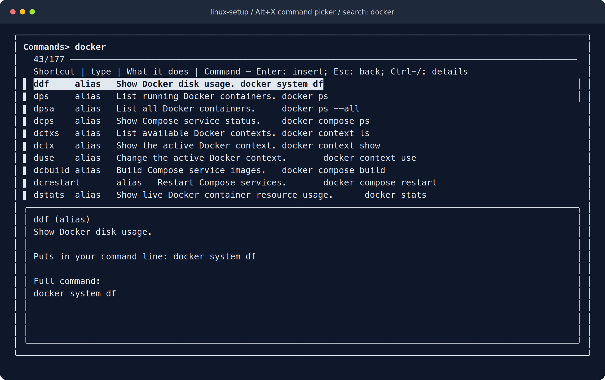
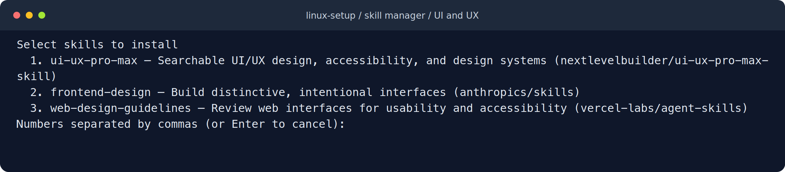

# Terminal preview gallery

[Documentation](README.md) · [Project overview](../README.md) · [Switch themes](customization.md#switch-the-prompt-theme)

## Custom themes

Wholespace, Unicorn, Tiwahu, Spaceship, Night Owl, and Kali have distinct
layouts, markers, and context displays. Each example shows `my-app/src`, the
immediate parent and current folder, with compact command history above the
active two-line prompt.



[PNG](assets/custom-themes.png) · [SVG](assets/custom-themes.svg) · [Choose a theme](themes.md)

## Quick-term

The default theme uses orange accents, a two-line prompt, directory and Git
context, command duration, and a clock. Completed commands use a compact
transient prompt in an interactive shell.



[PNG](assets/quick-term.png) · [SVG](assets/quick-term.svg) · [Theme source](../config/oh-my-posh/quick-term.omp.json)

## iTerm2

The alternative uses blue and lime segments, a status indicator, and a rocket
prompt. Battery and Python environment information appear when available.



[PNG](assets/iterm2.png) · [SVG](assets/iterm2.svg) · [Theme source](../config/oh-my-posh/iterm2.omp.json)

## Alt+X command picker

Search by shortcut, description, or full command. The preview contains the whole
definition. Enter inserts the selection for editing; it does not execute it.



[PNG](assets/command-picker.png) · [SVG](assets/command-picker.svg) · [Usage](terminal.md)

## AI skill manager

Choose your AI app, whether skills apply to all projects or one project, and one
or more work areas.
This menu shows the UI and UX choices available for Codex. Use arrows to move and Space to select
the skills you want, then review the source URLs before confirming installation.



[PNG](assets/skill-manager.png) · [SVG](assets/skill-manager.svg) · [Usage](skills.md)

## How these images are made

The theme previews render the repository's actual Oh My Posh configurations with
explicit [sample prompt data](assets/prompt.data.json): user `dev`, directory
`my-app/src` within `/home/dev/projects/my-app/src`, branch `main`, and a fixed example clock. Their command-reference
output comes from running `devhelp 'pnpm run'` against the current source. They
are rendered terminal examples, not screenshots of a personal workstation.

The picker image captures fzf in an isolated Zsh terminal, then renders its
visible character cells and colors. Capture is cancelled before selection.
The skill manager image captures the real selection menu in a temporary home
directory; it stops before any skill is selected or downloaded.
The window header and dark background belong to the image renderer, not to an
installed terminal application or desktop theme.

The PNGs include the rendered font and work without local font installation.
The SVGs keep editable text and may look different without the matching font.
Both formats are kept here for reuse in documentation or a future project
landing page. Retain the upstream theme attribution in [NOTICE.md](../NOTICE.md).

## Regenerate

Install this repository's tools, the `MesloLGM Nerd Font Mono` font, and
[Noto Emoji](https://github.com/google/fonts/tree/main/ofl/notoemoji) for the
alternative theme's rocket glyph first.
Then, from the repository root:

```sh
uv run --with cairosvg==2.9.1 --with pyte==0.8.2 scripts/render-previews.py
```

The renderer needs Linux PTY support, a system Cairo library, Zsh, fzf, and
Oh My Posh with `print --data` support. The checked-in images were rendered with
Oh My Posh 31.9.1. The Python packages are documentation-only dependencies;
normal installation does not install them.

The script writes five PNG/SVG pairs in `docs/assets/`. Add `--themes-only` to
render the themes and comparison gallery, or `--skills-only` for the skill manager.
Inspect the images after
changing a theme, command description, fzf layout, font, or rendering dependency.
It uses a temporary shell configuration and excludes private local commands.
