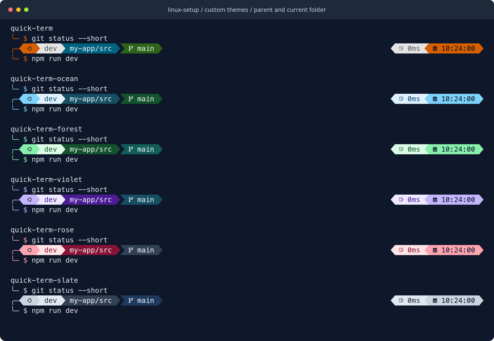

# Change your prompt theme

[User guides](README.md) · [Fonts](fonts-and-shell.md) · [Preview gallery](previews.md)

## Use the theme manager

```sh
theme
```

Choose **Choose an included theme** for the custom layouts below, or **Browse
more themes online** for the full Oh My Posh collection. You can also choose your
own theme file or web link. Use arrows to move, type to search, and Enter to choose.
Back or Esc cancels that choice.

After you select a theme, the menu closes and confirms **Theme changed to…**.
Run `reload`, or close and reopen the terminal, to see it. **Show current theme**
shows the saved choice, and **Restore the default theme** selects Quick-term.
Changes apply only to this device.

## Use commands directly

```sh
theme list                  # List included and online themes
theme current               # Show the saved selection
theme use paradox           # Use a theme from the online collection
reload

theme use iterm2            # Save the included alternative
reload

theme use ~/themes/work.omp.json
theme reset                 # Restore quick-term
reload
```

## Clean-detailed

Run `theme use clean-detailed` then `reload` to use the upstream
[Clean-detailed theme](https://github.com/JanDeDobbeleer/oh-my-posh/blob/main/themes/clean-detailed.omp.json).
It includes colored diamond segments for the OS, shell, memory usage, and command
timing, right-aligned Git information, a clock/path line, and a separate input
line. A blank terminal row separates the prompt lines for readability; terminal
themes cannot set pixel spacing. Its original transient prompt is preserved.
Quick-term remains the default.

Bash and Zsh share the saved selection. Bash transient prompts require
[ble.sh](https://ohmyposh.dev/docs/configuration/transient), loaded automatically
when installed at `~/.local/share/blesh/ble.sh` (respecting `XDG_DATA_HOME`). Without
ble.sh, the normal Bash prompt still works.

## Included layouts

These are different prompt designs adapted from the six themes you requested.
Each uses a two-line layout, with command input on the second line and a compact
prompt beside completed commands. Their shapes, markers, and context displays
come from their original designs.

| Select with `theme use NAME` | Layout | Original design |
| --- | --- | --- |
| `setup-wholespace` | Spaced diamond cards, a clock, and computer usage details | [Wholespace](https://github.com/JanDeDobbeleer/oh-my-posh/blob/d01ca021d6ceb899e252884f3a95db5969a4b8fd/themes/wholespace.omp.json) |
| `setup-unicorn` | Powerline ribbon with a unicorn command marker | [Unicorn](https://github.com/JanDeDobbeleer/oh-my-posh/blob/d01ca021d6ceb899e252884f3a95db5969a4b8fd/themes/unicorn.omp.json) |
| `setup-tiwahu` | Compact text badges, language icons, and a shell-specific marker | [Tiwahu](https://github.com/JanDeDobbeleer/oh-my-posh/blob/d01ca021d6ceb899e252884f3a95db5969a4b8fd/themes/tiwahu.omp.json) |
| `setup-spaceship` | Minimal text with “in” and “on” labels and a chevron marker | [Spaceship](https://github.com/JanDeDobbeleer/oh-my-posh/blob/d01ca021d6ceb899e252884f3a95db5969a4b8fd/themes/spaceship.omp.json) |
| `setup-night-owl` | Rounded tabs, contextual badges, and double-arrow input | [Night Owl](https://github.com/JanDeDobbeleer/oh-my-posh/blob/d01ca021d6ceb899e252884f3a95db5969a4b8fd/themes/night-owl.omp.json) |
| `setup-kali` | Bracketed user and project details connected to a second-line prompt | [Kali](https://github.com/JanDeDobbeleer/oh-my-posh/blob/d01ca021d6ceb899e252884f3a95db5969a4b8fd/themes/kali.omp.json) |

`quick-term` remains the default, and `iterm2` is another included option.
Older palette names such as `quick-term-ocean` now point to Quick-term so saved
selections keep working. The palette variants no longer appear as separate choices.



Try a layout:

```sh
theme use setup-kali
reload
```

Existing layouts now use their original path formatting rather than forcing
all paths to parent/current. Quick-term and iterm2 use their earliest repository
path settings; the six adapted themes use their upstream source settings.
Theme file locations, saved selections, and the default theme remain compatible.

The `setup-` names are customized copies. The original online themes can still
be selected by their original names, for example `theme use kali`, or through
**Browse more themes online**. Those originals keep their own layouts and path
styles. Browsing the online collection needs GitHub access; a previously loaded
list is reused when offline. Included themes and your own files work offline.

The layouts use Oh My Posh's [path formatting](https://ohmyposh.dev/docs/segments/system/path)
and [transient prompts](https://ohmyposh.dev/docs/configuration/transient).
See the [preview gallery](previews.md) for larger examples and [NOTICE](../NOTICE.md)
for source attribution. All six copies were taken from the source version linked
in the table above.

## Where the selection is saved

The manager writes `~/.config/linux-setup-local/theme.zsh`, respecting
`XDG_CONFIG_HOME`. Bash and Zsh read it before initializing the prompt. It takes
precedence over `LINUX_SETUP_POSH_THEME` in your local zshenv. For manual control,
remove the manager's `theme.zsh` file and put the export in your local zshenv.
Existing shell-level exports continue to work when no manager selection exists.

The manager can also run before installation:

```sh
python3 scripts/theme_manager.py
```

An installed and configured Oh My Posh is needed to display the theme. If the
icons are unreadable, follow [font setup](fonts-and-shell.md).
