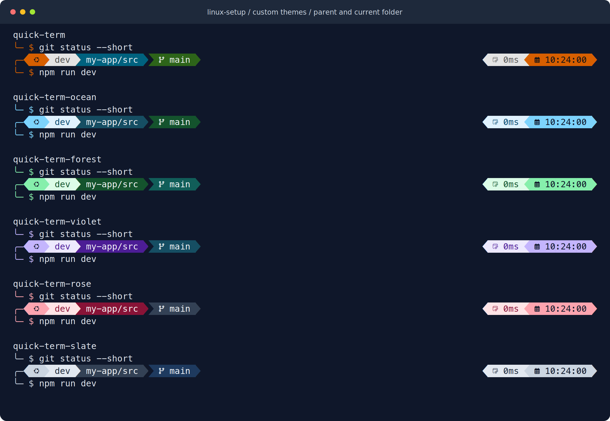

# Change your prompt theme

[User guides](README.md) · [Fonts](fonts-and-shell.md) · [Preview gallery](previews.md)

## Use the theme manager

```sh
theme-manager
```

Choose a bundled theme, browse the upstream Oh My Posh themes, or enter an
existing local JSON file or HTTPS configuration URL. Use arrows to move, type
to search when fzf is available, and press Enter to select. Back or Esc leaves
that selection unchanged. After saving a theme, apply it in your current shell:

```sh
reload
```

The menu's **Show current theme** displays the saved selection. **Restore the
default theme** returns to quick-term. Changes apply only to this device.

## Use commands directly

```sh
theme-manager list                  # List bundled and upstream names
theme-manager current               # Show the saved selection
theme-manager use paradox           # Save an upstream theme name
reload

theme-manager use iterm2            # Save the bundled alternative
reload

theme-manager use ~/themes/work.omp.json
theme-manager reset                 # Restore quick-term
reload
```

## Bundled themes

The six custom themes share a two-line layout: username, path, and Git context
on the first line; command input on the second. Completed commands collapse to
a compact transient prompt. Each prompt leaves one space before your input.
The clock and command duration are hidden in terminals narrower than 80 columns.

| Theme | Colors |
| --- | --- |
| `quick-term` | Orange, blue, and green; the default |
| `quick-term-ocean` | Sky blue and deep teal |
| `quick-term-forest` | Mint and forest green |
| `quick-term-violet` | Lavender and purple |
| `quick-term-rose` | Rose and burgundy |
| `quick-term-slate` | Silver and slate blue |
| `iterm2` | The original blue and lime alternative, with a rocket prompt |



Select any bundled name directly:

```sh
theme-manager use quick-term-ocean
reload
```

All bundled themes show only the immediate parent and current folder after the
username. For example, `/home/user/projects/my-app/src` appears as `my-app/src`;
entering its `components` folder changes it to `src/components`. Root displays
`/`, and a folder directly under root displays its own name. Long names, spaces,
and Unicode characters are kept. Upstream themes retain their own path styles.

The layout uses Oh My Posh's [path formatting](https://ohmyposh.dev/docs/segments/system/path)
and [transient prompts](https://ohmyposh.dev/docs/configuration/transient).
See the [preview gallery](previews.md) for larger examples. The `iterm2` name
does not require the iTerm2 app.

Browsing upstream themes needs GitHub access; a previously fetched list is used
when offline. The list follows the Oh My Posh version pinned by this setup. You
can select another upstream name directly with `theme-manager use NAME`.
Upstream names and HTTPS URLs need network access when Oh My Posh loads them;
local theme files work offline. The manager does not copy or delete your local
JSON files.

## Where the selection is saved

The manager writes `~/.config/linux-setup-local/theme.zsh`, respecting
`XDG_CONFIG_HOME`. Zsh reads it before initializing the prompt. It takes
precedence over `LINUX_SETUP_POSH_THEME` in your local zshenv. For manual control,
remove the manager's `theme.zsh` file and put the export in your local zshenv.
Existing shell-level exports continue to work when no manager selection exists.

The manager can also run before installation:

```sh
python3 scripts/theme_manager.py
```

An installed and configured Oh My Posh is needed to display the theme. If the
icons are unreadable, follow [font setup](fonts-and-shell.md).
